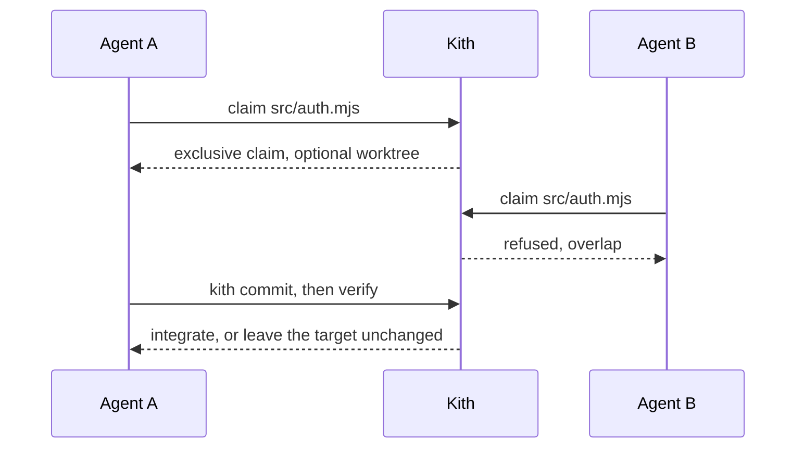

<p align="center">
  
</p>

<p align="center">
  <a href="https://www.npmjs.com/package/kith-coord"></a>
  <a href="https://www.npmjs.com/package/kith-coord"></a>
  <a href="https://github.com/connorhriley/kith/actions/workflows/ci.yml"></a>
  <a href="https://github.com/connorhriley/kith/actions/workflows/windows.yml"></a>
  <a href="LICENSE"></a>
  <a href="https://registry.modelcontextprotocol.io/v0.1/servers/io.github.connorhriley%2Fkith/versions/latest"></a>
</p>

<p align="center">
  <a href="#quick-start">Quick start</a> · <a href="#demo">Demo</a> · <a href="#why-not-just-git-worktrees">Why not worktrees</a> · <a href="https://marketplace.visualstudio.com/items?itemName=kith-coord.kith">VS Code</a> · <a href="https://open-vsx.org/extension/kith-coord/kith">Cursor / Open VSX</a> · <a href="docs/integrations.md">Integrations</a> · <a href="docs/usage.md">CLI &amp; API</a> · <a href="CONTRIBUTING.md">Contribute</a>
</p>

Kith is vendor-neutral local coordination for cooperating coding agents: scoped work claims, isolated Git worktrees, shared local resource mutexes, and verified integration, with no hosted service.

Several agents editing one repository clobber each other's files, dev-server ports, databases, and commits. One agent changes an interface while another is building against it. Two agents write the same file. Separate Git worktrees still race for a port or a package install.

## Quick start

Requires **Git 2.38+** and **Node.js 22.13+ on 22.x, or Node.js 24+**.

```sh
npm i -g kith-coord && kith install
```

`kith install` puts `kith` on your `PATH` and keeps that runtime outside the npx cache. It writes a global MCP entry for each detected client, using the compact tool profile (`kith mcp --compact`), and installs silent-solo `--auto` hooks for Claude Code and Cursor. One agent stays at **Watching only** and does not write coordination state. When another writer overlaps, the hooks join Kith and isolate that work into a worktree or a claim. On macOS it also loads a login LaunchAgent (`dev.kith.radar`) unless you pass `--no-autostart` or `--no-radar`. It does not claim any files. An agent claims when it starts a task.

Codex CLI has no native tool hooks, so it uses the MCP tools. Linux and Windows skip the menu bar; use `kith watch`.

Directories that scan a repository for an MCP server read the committed [`.mcp.json`](.mcp.json): `npx -y kith-coord mcp` over stdio. That entry does not pin a checkout and does not install hooks. Editor install, the pinned `npx` setup, and upgrade notes are under [Install details](#install-details).

## Demo


Recorded from the real `kith` CLI in a temporary repository. `auth` (Claude Code) claims `src/auth.mjs`. `billing` (Cursor) claims the same path and is refused. `auth` edits the file and `kith commit` records only that file. `kith status` lists both sessions and the claim. Both sessions use this terminal's process id, because the CLI is driving them; two editor processes would show two ids. The claim is still per agent: `billing` does not receive the lock.

The tape pipes `kith begin` through [`claim.jq`](assets/demo/claim.jq), which prints the claim fields and leaves out the session token. Reproduce it from a built checkout:

```sh
pnpm build && vhs assets/demo/claims.tape
```

## How it works

Each agent has an id and claims the paths it will change. Kith stores that claim in SQLite under the repository (`.coord/`). An exclusive claim that overlaps a live claim is refused, and no lock is taken. In the default worktrees mode, `--worktree` (MCP `isolateWorktree: true`) checks out a separate Git worktree for the task. `kith mode main` keeps every agent in the shared checkout and still enforces the claims.

Ports and other shared local resources are separate from file claims. `kith dev` reserves a port. `kith mutex` runs one command at a time under a named lock, for a package install or a database. `kith commit` commits only the calling session's files, through a temporary Git index, so a shared checkout does not pick up another agent's edits.

Finishing a worktree task checkpoints the work and integrates through a staging worktree. You can pass the project's verification command. If it fails, the integration target is left unchanged and the worktree remains for repair. Claims coordinate clients that call Kith, or whose auto hooks have joined. They are not a sandbox for every process on the machine.



Coordination stays on this machine. Kith does not call a model API and does not run a hosted service.

## Why not just git worktrees?

A Git worktree gives each agent a directory and a branch. It does not record who owns a path, so two agents can edit the same files and only collide when someone merges. It does not reserve a dev-server port, serialise a package install, or hold a shared database. It does not run your verification command before the result is integrated, and it does not carry a note to the next session.

Kith still uses worktrees when you want separate files. The extra state is the claim, the mutex, and the checked integration. `kith mode main` is the same claims without a worktree, for a checkout you would rather share.

| | Git worktrees | Kith |
| --- | --- | --- |
| Separate working files | One directory and branch per checkout | Optional worktree per task. `kith mode main` stays in one checkout |
| Overlapping edits | Found when you merge | Exclusive claim refused before the second agent edits |
| Dev-server ports | Not handled | `kith port` and `kith dev` reserve a port |
| Shared commands and databases | Not handled | `kith mutex` serialises them |
| Check before integration | You arrange it | Your verification command. Failure leaves the target unchanged |
| Who is working | `git worktree list` | `kith status` and `kith brief`: claims, waits, handoffs |
| Next session | Nothing carried across | Handoff notes for the same scope |
| Hosted service | None | None |

## What Kith does

| Need | Kith provides |
| --- | --- |
| Keep tasks from overlapping | Scoped claims with conflict responses |
| Give agents separate working files | Git worktrees with an explicit integration step |
| Check work before integration | Your project's verification command |
| Share local tools | Port reservations and supervised command mutexes |
| Know what is going on before you start | `kith brief`: who is active on what, overlapping claims, open handoffs and conflicts. Read-only, no session needed |
| Work the way you do | Worktree isolation, or one shared checkout with scope claims (`kith mode main`) |
| Keep what an agent learned | Handoff notes that survive a session boundary and reach whoever works the same scope next |
| See what is happening | Session/task state through CLI/MCP; optional read-only editor and worktree views |

Kith fits workflows where you already launch multiple coding agents and want them to coordinate. It does not choose models, write prompts, or launch a fleet for you. Worktrees separate files; Kith adds shared ownership and resource coordination.

The [reliability contract](docs/reliability.md) defines ownership, verification, recovery and enforcement boundaries. Claims coordinate cooperating clients; hooks do not sandbox filesystem access. Scope matching follows a [documented grammar](docs/path-and-scope-rules.md). Contract-change reports and exact-name reuse hints are advisory.

## Install details

Requires **Git 2.38+** and **Node.js 22.13+ on 22.x or Node.js 24+**. Full workflows target macOS and Linux. Native Windows MCP checks cover claims, worktrees, ports, integration and recovery; supervised mutex commands and shell hooks require macOS/Linux or WSL. See the [support evidence](docs/client-validation.md#native-windows).

Git recording and integration require a commit identity configured for the repository (`user.name` and `user.email`). Kith does not change your global Git identity.

### Upgrading

Stop existing Kith connections first. Back up stopped coordination state (including SQLite sidecars) and retain worktrees; upgrade all coordinators sharing a repository together. The storage schema stays 3 and the protocol stays 1.6.0. Databases already on schema 3 open without a version migration. The first open on 0.1.8 or later creates an optional `handoffs` table; binaries from 0.1.6 and 0.1.7 ignore that table and keep working, but they do not read or write handoff notes. An upgrade from schema 2 still applies the 0.1.6 migration to schema 3, which older binaries refuse. After upgrading, run `kith install` so hooks and client entries use this runtime. `kith doctor` reports a hook or MCP entry still pinned to an older runtime. Existing custom launchers are preserved; review their pinned version before reconnecting. On macOS, `kith install` and `kith setup` register a login LaunchAgent unless `--no-autostart` or `--no-radar` is passed. See [recovery guidance](docs/reliability.md#recovery).

### VS Code or Cursor

Install **Kith** (`kith-coord.kith`) from the [VS Code Marketplace](https://marketplace.visualstudio.com/items?itemName=kith-coord.kith) or [Cursor / Open VSX](https://open-vsx.org/extension/kith-coord/kith). You can also search for `kith-coord.kith` in the editor's Extensions view.

To select release **0.1.9** explicitly with an editor CLI already on your `PATH`:

```sh
code --install-extension kith-coord.kith@0.1.9
cursor --install-extension kith-coord.kith@0.1.9
```

Use the command for your editor. A marketplace lookup can temporarily select an older version; the [extension guide](extensions/editor/README.md#install) also links the published 0.1.9 VSIX.

Open a trusted local Git checkout and approve Kith's MCP server through the editor. The extension bundles the coordination server, detects Node, and preserves existing MCP entries, hooks and tool permissions. **No global npm install is needed.** It registers the compact tool profile (`kith.mcp.profile`, `compact` by default, or `full`), shows a read-only global hook status note in Output, and adds **Kith: Install Global Hooks & Autostart** (`kith.installGlobal`). The bundled extension does not include the macOS menu-bar helper; run `kith install` from the CLI on macOS for Radar login autostart. Each agent still needs to use Kith's tools; installing the extension alone does not enforce claims on other writers.

Start with a scoped task:

```text
Use Kith to begin an isolated task in this repository with a unique agent ID.
Claim only the files this task needs, edit the returned worktree, and report edits.
Run the project checks and complete through Kith with that verification command.
```

The [extension guide](extensions/editor/README.md) covers settings and existing configurations; [recorded editor checks](docs/client-validation.md#editor-marketplaces-and-signed-in-chats) distinguish installation, native MCP registration and signed-in task results.

### CLI and other MCP clients

Configure detected clients and add project instructions with:

```sh
npx --yes --package kith-coord@0.1.9 kith setup
```

**`kith install`** is the one-command onboarding path. `kith setup` remains a compatible alias:

- Configures global MCP servers with the concise **`--compact`** tool profile by default (`kith mcp --compact`, or `--full` for the complete surface).
- Installs global silent-solo `--auto` hooks for **Claude Code** (`~/.claude/settings.json`) and **Cursor** (`~/.cursor/hooks.json`). Solo work stays zero-write (`Watching only`); when concurrent activity overlaps, hooks auto-join Kith and isolate writers into worktrees or leases.
- On **macOS**, installs and starts a login `LaunchAgent` (`dev.kith.radar`) for background menu-bar Radar, and opens the read-only view. `--no-autostart` or `--no-radar` skips the login item. Repeat setup keeps the existing workspace.
- **`kith uninstall`** removes the macOS `LaunchAgent`, global Kith hooks, global MCP entries, retained runtimes and launcher symlinks.

Note the platform and client boundaries: **Codex CLI** does not expose native pre/post tool hooks, so it coordinates through `--compact` MCP tools and Radar/watcher observations rather than automatic hook interception. **Linux and Windows** skip macOS menu-bar autostart and use `kith watch` for passive supervision.

Durable setup starts with **0.1.7** (retaining an exact self-contained runtime outside npx's cache, verifying MCP discovery, and backing up modified files). Existing custom Kith launchers, peer servers, hooks and permissions are preserved. Reconnect the client and approve its MCP server through the client's normal controls.

Day to day, run `kith` (a read-only status overview in a terminal), `kith status`, `kith brief`, `kith run`, `kith gc`, `kith doctor [path]`, or `kith help --all`. The view says **Watching only** until a task or concurrent overlap is recorded. `kith install --dry-run` and `kith setup --dry-run` preview without writes.

[`.mcp.json`](.mcp.json) is the directory discovery entry: `npx -y kith-coord mcp`. It is not a pin to this repository. `kith install` does not read or edit it, and `kith doctor` only reports that the launcher file is present; neither command starts the server or creates `.coord` state. A client that loads project MCP config, such as Claude Code, can start that published package from the file. Because `--repo` is omitted, the process does not pin this checkout or open the database until a tool call names one. `kith init` still replaces the `kith` server in a project `.mcp.json` with a launcher for the machine you are on; do not commit that rewrite over the discovery entry.

For source installation and the disposable demo, use the pinned **pnpm 10.20.0**:

```sh
git clone https://github.com/connorhriley/kith.git
cd kith
corepack enable
pnpm install --frozen-lockfile
pnpm build
```

### See it work

The [recording above](#demo) is the CLI. This example is two real MCP clients:

```sh
pnpm demo
```

The demo starts **two real MCP clients**, gives each a separate Git worktree in a temporary repository, refuses an overlapping claim, records their edits, runs commands under a mutex, and verifies/integrates both changes. It removes the temporary repository afterward. No model calls or client credentials are needed.

```text
auth: claimed src/auth.mjs in an isolated worktree
billing: overlapping claim on src/auth.mjs refused
billing: claimed src/billing.mjs in an isolated worktree
auth: checked its worktree through the MCP command supervisor
auth: isolated edit reported, verified, and integrated
billing: checked its worktree through the MCP command supervisor
billing: isolated edit reported, verified, and integrated
Two real MCP clients completed work in separate worktrees. Disposable example passed.
```

The implementation is in [examples/two-agents.mjs](examples/two-agents.mjs). This demonstrates the coordination protocol; [native-client validation](docs/client-validation.md) separately exercises installed coding clients.

### Client support

The editor extension bundles the server and offers it through native MCP registration; no global npm install is needed. Installing an extension or writing MCP configuration alone does not enforce claims on writers that do not call Kith tools unless global `--auto` hooks are installed for that client. Existing custom Kith entries retain precedence.

| Client | Setup and behavior |
| --- | --- |
| VS Code / Cursor | Marketplace extension with `kith.mcp.profile` set to `compact` by default; **Kith: Install Global Hooks & Autostart** runs `kith install` |
| Claude Code and Cursor | Detected client configuration through `kith install` or `kith setup`; silent-solo `--auto` hooks join when work overlaps |
| Codex CLI | Detected global MCP configuration (`--compact` by default). Codex CLI has no native tool hooks, so coordination uses MCP tools and Radar or `kith watch` |
| Claude Desktop | Detected MCP configuration via `kith install` / `kith setup` |
| Other MCP clients | stdio server via `kith mcp` (`--compact` or `--full`); client-specific validation required |

Native evidence is version-specific. See [client validation](docs/client-validation.md), [advanced integration setup](docs/integrations.md) and [session ownership](docs/sessions-and-mutexes.md). The npm package is **`kith-coord`** and the command is **`kith`**; the unrelated npm package `kith` is not this project.

## Dev servers and shared config

`kith dev` runs a server with its allocated `PORT` and supports explicit `{port}` arguments. File claims also accept an optional bounded wait:

```sh
kith dev --agent web-a -- npm run dev -- --port '{port}'
# Within an existing owned session:
kith lock acquire --agent worker-1 --scope package.json --wait --wait-ms 30000
```

See [dev-server launch and waiting claims](docs/usage.md#launch-a-dev-server-on-its-allocated-port) for framework flags, session setup, cancellation, and MCP usage.

## Read-only Radar

From 0.1.8, macOS `kith install` and `kith setup` load a `LaunchAgent` (`dev.kith.radar`) so menu-bar Radar runs in the background and restarts across logins for the selected checkout or workspace. It uses the retained installation, so clearing the npx cache does not break it. Repeat runs keep an existing Radar workspace selected. Use **Switch Workspace** in its menu to change it.

`kith install --no-autostart` (or `--no-radar`) configures MCP and hooks without loading the macOS login agent (useful on headless machines); `--dry-run` never writes or launches anything. Linux and Windows skip the macOS menu-bar app and `LaunchAgent`, using `kith watch` for passive monitoring instead (external IDE `presence.db` discovery is opt-in via `--include-presence`). Remove the login item anytime with `kith uninstall`, or inspect manually with:

```sh
kith watch /path/to/workspace --once --json
kith menubar /path/to/workspace  # macOS 12+, Intel or Apple Silicon
```

The menu and editor lead with recorded tasks, current file claims, shared-resource waits and integrations that need inspection. A registered session without a task is shown separately. Saved checkouts and path comparisons stay in details; nothing is automatically deleted. The menu's default view omits the file-timestamp feed.

**Watching only** means no active Kith task is recorded. Shared dirty paths are files to review before integration, not a proven merge conflict. **Status unavailable** remains explicit when state cannot be inspected safely. Reads use private snapshots without renewing owners or migrating the original database. See [observation limits](docs/usage.md#optional-read-only-worktree-observations).

## How a task moves through Kith

0. **Look first.** `kith brief` (or `kith_brief`) shows who is active on what, claims that overlap your scope, open handoffs and conflicts. It is read-only and needs no session.
1. **Begin through MCP.** Call `kith_begin_work` with a unique `agentId`, explicit `scopeGlobs`, and `isolateWorktree: true`. The connection retains session ownership; no shell exports are needed for this MCP-only workflow.
2. **Claim a scope.** Cooperating clients receive a conflict when an exclusive claim overlaps another claim.
3. **Do the work.** Edit the returned `worktree.worktreePath`, report edits with `kith_record_file_edit`, and use `kith_run_with_mutex` for serialized commands. Heartbeat before expiry and keep the owning connection open.
4. **Leave a handoff.** When you finish, get blocked or must stop, call `kith_write_handoff` with what is done, what remains, what failed and what you learned. `releaseTask` hands the task back to the queue. If a session ends without a note, Kith records what it observed. The next agent on the same scope receives these notes from `kith_begin_work` or `kith_claim_next_task`, labelled as untrusted information to verify.
5. **Verify and complete.** For a worktree, Kith checkpoints changes and integrates through a separate staging worktree. The target may hold unrelated uncommitted work, but not edits to files the integration changes. Supply a verification command to check more than Git mergeability.

Failed verification leaves the target unchanged and keeps the worktree for repair. Successful integration also retains the worktree until explicit cleanup. External Git writers must still coordinate.

Inspect through `kith_get_status` or `kith status`: worktree paths/branches, dirty-file overlap, ahead/behind, heartbeat/commit age and FIFO waiters are included. Use `kith_preview_integrate` for committed-tree conflict paths before completing. Normal status may reap expired owners. For non-mutating recovery inspection use:

```sh
kith status --offline
kith recover
kith doctor
```

Optional Claude/Cursor hooks support `--enforcement block` (default), `warn` and `off`; see [setup and safe uninstall](docs/integrations.md). The [versioned protocol](docs/protocol.md) records the tool schemas and ownership semantics.

For MCP, CLI and library examples, see [workflows](docs/usage.md).

## Project status

The suite exercises process contention, session ownership, command cancellation and disconnects, generated hooks, MCP workflows, and worktree integration. Clean-package checks install the built distribution in a separate consumer project. Native-client reports include exact versions and outcomes.

The CI badge links to current hosted results; local tests and recorded native runs do not establish that every platform or client release passes. Repository discovery, physical path checks, exact supported glob matching and Git conflict refusal have dedicated regressions. Recovery checks cover interrupted upgrades, stopped database/WAL backups and retained worktree continuation. The [reliability contract](docs/reliability.md) records the boundaries of those scenarios; native-client coverage is listed above.

- [Reliability contract](docs/reliability.md): behavior, boundaries, and recovery
- [Architecture](docs/architecture.md): storage, adapters, and Git integration
- [Roadmap](docs/roadmap.md): priorities and completion gates
- [Changelog](CHANGELOG.md): behavior changes and migration notes

## Contributing

The most useful contributions reproduce a concrete failure or improve a real multi-agent workflow. Include a disposable fixture, expected behavior, and a way to verify the change. Start with [contributor setup and entry points](CONTRIBUTING.md).

For bugs, use the [bug report form](https://github.com/connorhriley/kith/issues/new?template=bug_report.yml). For a proposed workflow, use the [feature request form](https://github.com/connorhriley/kith/issues/new?template=feature_request.yml). Keep tokens, source snapshots, and `.coord` state out of public diagnostics; use the [security reporting guidance](SECURITY.md) for sensitive reports.

[MIT licensed](LICENSE). Participation follows the [community expectations](CODE_OF_CONDUCT.md).
