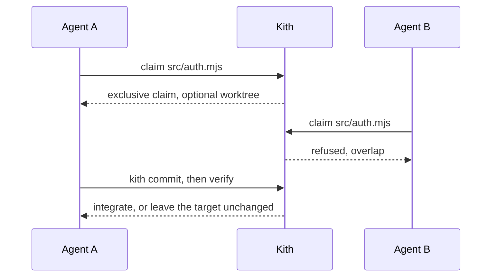

<p align="center">
  
</p>

<p align="center">
  <a href="https://www.npmjs.com/package/kith-coord"></a>
  <a href="https://www.npmjs.com/package/kith-coord"></a>
  <a href="https://github.com/connorhriley/kith/actions/workflows/ci.yml"></a>
  <a href="https://github.com/connorhriley/kith/actions/workflows/windows.yml"></a>
  <a href="LICENSE"></a>
  <a href="https://registry.modelcontextprotocol.io/v0.1/servers/io.github.connorhriley%2Fkith/versions/latest"></a>
</p>

<p align="center">
  <a href="#quick-start">Quick start</a> · <a href="#demo">Demo</a> · <a href="#why-not-just-git-worktrees">Why not worktrees</a> · <a href="#how-kith-compares">Compare</a> · <a href="docs/install.md">Install</a> · <a href="https://marketplace.visualstudio.com/items?itemName=kith-coord.kith">VS Code</a> · <a href="https://open-vsx.org/extension/kith-coord/kith">Cursor / Open VSX</a> · <a href="docs/integrations.md">Integrations</a> · <a href="docs/usage.md">CLI &amp; API</a> · <a href="CONTRIBUTING.md">Contribute</a>
</p>

Kith does not launch agents. It is the ownership layer under the ones you already run: Claude Code, Codex, Cursor, and any other MCP client.

Those agents share file claims, a dev-server port, and one-at-a-time commands such as a package install. When you supply a check, a worktree integrates only after that check passes; a failure leaves the target unchanged. There is no account and no coordination server. The macOS menu bar from `kith install` is an optional read-only status view, not a launcher.

## Quick start

Requires **Git 2.38+** and **Node.js 22.13+ on 22.x, or Node.js 24+**.

```sh
npm i -g kith-coord && kith install
```

`kith install` puts `kith` on your `PATH` and keeps that runtime outside the npx cache. It writes a global MCP entry for each detected client (`kith mcp --compact`) and installs silent-solo `--auto` hooks for Claude Code and Cursor. One agent stays at **Watching only**. When another writer overlaps, the hooks join Kith. Install does not claim any files. Codex has no native tool hooks, so it uses the MCP tools. Linux and Windows skip the menu bar; use `kith watch`.

A directory that scans a repository for an MCP server reads the committed [`.mcp.json`](.mcp.json): `npx -y kith-coord mcp` over stdio. That entry does not pin a checkout and does not install hooks. Upgrades, the editor extension, and the client matrix are in [Install](docs/install.md).

### Claude Code plugin

When Claude Code is the only client, install the plugin instead of a global npm package. In Claude Code:

```text
/plugin marketplace add connorhriley/kith
/plugin install kith@kith
```

The plugin runs `npx -y kith-coord` for the same hooks and for an MCP server (`kith mcp --compact`). It does not configure Cursor, Codex, or the menu bar. Using it together with `kith install` is safe: the plugin hooks exit when those Claude hooks are already registered, and `kith doctor` does not treat that as a fault. [Which to use](docs/install.md#which-to-use).

## Demo


Recorded from the real `kith` CLI in a temporary repository. `auth` (Claude Code) claims `src/auth.mjs`. `billing` (Cursor) claims the same path and is refused. `auth` edits the file and `kith commit` records only that file. `kith status` lists both sessions and the claim. Both sessions use this terminal's process id, because the CLI is driving them; two editor processes would show two ids. The claim is still per agent: `billing` does not receive the lock.

Each `kith begin` is one line from the CLI's claim fields ([`claim.jq`](assets/demo/claim.jq)); the session token is not printed. The owner pid, client, and title are set in the hidden setup, so the typed commands stay short. Reproduce it from a built checkout:

```sh
pnpm build && vhs assets/demo/claims.tape
```

## How it works

Each agent has an id and claims the paths it will change. Kith stores that claim in SQLite under the repository (`.coord/`). An exclusive claim that overlaps a live claim is refused, and no lock is taken. In the default worktrees mode, `--worktree` (MCP `isolateWorktree: true`) checks out a separate Git worktree for the task. `kith mode main` keeps every agent in the shared checkout and still enforces the claims.

Ports and other shared local resources are separate from file claims. `kith dev` reserves a port, scanning from 3000 unless you set a base. `kith port` reserves one too, scanning from 3100. `kith mutex` runs one command at a time under a named lock, for a package install or a database. `kith commit` commits only the calling session's files, through a temporary Git index, so a shared checkout does not pick up another agent's edits.

Finishing a worktree task checkpoints the work and integrates through a staging worktree. Pass the project's check. If it fails, or if it changes the staging tree, the integration target is left unchanged and the source worktree remains for repair. With no check, a clean Git merge is the gate. Claims coordinate clients that call Kith, or whose auto hooks have joined. They are not a sandbox for every process on the machine.



Coordination stays on this machine. Kith does not call a model API and does not run a hosted service. CLI and MCP clients share `.coord/state.db`. There is no coordination server to leave running.

## Why not just git worktrees?

A Git worktree gives each agent a directory and a branch. It does not record who owns a path, so two agents can edit the same files and only collide when someone merges. It does not reserve a dev-server port, serialise a package install, or hold a shared database. It does not run your check before the result is integrated, and it does not carry a note to the next session.

Kith still uses worktrees when you want separate files. The extra state is the claim, the mutex, and the checked integration. `kith mode main` is the same claims without a worktree, for a checkout you would rather share.

| | Git worktrees | Kith |
| --- | --- | --- |
| Separate working files | One directory and branch per checkout | Optional worktree per task. `kith mode main` stays in one checkout |
| Overlapping edits | Found when you merge | Exclusive claim refused before the second agent edits |
| Dev-server ports | Not handled | `kith port` and `kith dev` reserve a port |
| Shared commands and databases | Not handled | `kith mutex` serialises them |
| Check before integration | You arrange it | Your check, when you supply one. Failure leaves the target unchanged |
| Who is working | `git worktree list` | `kith status` and `kith brief`: claims, waits, handoffs |
| Next session | Nothing carried across | Handoff notes for the same scope |
| Hosted service | None | None |

## How Kith compares

Most multi-agent tools solve the problem by keeping agents apart: a worktree, a container or a VM each. That stops two agents typing into the same directory. It does not stop them changing the same file on different branches, fighting over port 3000, running two package installs at once, or integrating work that has not passed a check. Kith is the layer that handles those, underneath whichever agents and launcher you already use.

| If you use… | It gives you | Kith adds |
| --- | --- | --- |
| [Claude Code `--worktree`](https://code.claude.com/docs/en/worktrees) | A worktree per session, and messages between sessions | File claims shared with Codex, Cursor and other MCP clients; port and command locks; a worktree integrates only after the check you supply passes |
| [Orca](https://github.com/stablyai/orca), [Orchestrator.inc](https://github.com/OrchestratorInc/agent-orchestrator), [Claude Squad](https://github.com/smtg-ai/claude-squad), [CCManager](https://github.com/kbwo/ccmanager) | An app or TUI that launches agents, each in its own worktree | Ownership of files *across* those worktrees, so an overlapping claim is refused before the second cooperating agent edits, rather than found at merge |
| [container-use](https://github.com/dagger/container-use) | A container and branch per agent | The same claims and checked integration, without containers. container-use isolates more strongly; Kith only binds agents that cooperate |
| [claude-bulkhead](https://github.com/dooly6276/claude-bulkhead) | Hooks that block cross-session kills, port clashes, `git add -A` sweeps and RAM overload | Exclusive file claims, a per-agent `kith commit` that records only that session's files, and checked integration. bulkhead covers process and machine safety that Kith does not; they work side by side |
| [MCP Agent Mail](https://github.com/Dicklesworthstone/mcp_agent_mail_rust) | Agent identities, inboxes and advisory file reservations through a local server | Enforced claims through hooks, worktree isolation and checked integration, with no coordination server to leave running. Agent Mail does messaging; Kith does not |

What Kith isn't: it does not launch agents, choose models or provide a control dashboard, and it is not a sandbox. The menu bar and editor views are read-only status. Claims bind agents that call Kith or whose hooks have joined. Native edit-blocking hooks are for Claude Code and Cursor; other clients use the MCP tools. Kith does not adopt a worktree another tool has already created. A claim is on the repository path, and isolation uses a worktree Kith creates.

A port or command lock applies when the agent uses `kith dev`, `kith port`, or `kith mutex` (or the optional package-manager shims). The hook does not take that lock for an ordinary shell command. With no check supplied, worktree integration still requires a clean Git merge and leaves the target unchanged when that merge conflicts.

## What Kith does

| Need | Kith provides |
| --- | --- |
| Keep tasks from overlapping | Scoped claims with conflict responses |
| Give agents separate working files | Git worktrees with an explicit integration step |
| Check work before integration | Your project's check, when you supply one |
| Share local tools | Port reservations and supervised command mutexes |
| Know what is going on before you start | `kith brief`: who is active on what, overlapping claims, open handoffs and conflicts. Read-only, no session needed |
| Work the way you do | Worktree isolation, or one shared checkout with scope claims (`kith mode main`) |
| Keep what an agent learned | Handoff notes that survive a session boundary and reach whoever works the same scope next |
| See what is happening | Session and task state through CLI and MCP; optional read-only editor and menu-bar views |

The [reliability contract](docs/reliability.md) is the boundary: ownership, checks, recovery, and what is not enforced. Scope matching follows a [documented grammar](docs/path-and-scope-rules.md). Contract-change reports and exact-name reuse hints are advisory.

Day to day: `kith`, `kith status`, `kith brief`, `kith run`, `kith gc`, `kith doctor`, or `kith help --all`. A task moves through begin, claim, edit, handoff, and complete; the commands are in [Workflows](docs/usage.md#how-a-task-moves-through-kith). Dev servers, waiting claims, and Radar are in [Install](docs/install.md) and [Usage](docs/usage.md).

## Project status

The suite exercises process contention, session ownership, command cancellation and disconnects, generated hooks, MCP workflows, and worktree integration. The CI badge is the current hosted result. Local tests do not establish that every platform or client release passes.

- [Reliability contract](docs/reliability.md): behaviour, boundaries, and recovery
- [Architecture](docs/architecture.md): storage, adapters, and Git integration
- [Roadmap](docs/roadmap.md): priorities and completion gates
- [Changelog](CHANGELOG.md): behaviour changes and migration notes
- [Client validation](docs/client-validation.md): version-specific native evidence

## Contributing

The most useful contributions reproduce a concrete failure or improve a real multi-agent workflow. Include a disposable fixture, expected behaviour, and a way to verify the change. Start with [contributor setup and entry points](CONTRIBUTING.md).

For bugs, use the [bug report form](https://github.com/connorhriley/kith/issues/new?template=bug_report.yml). For a proposed workflow, use the [feature request form](https://github.com/connorhriley/kith/issues/new?template=feature_request.yml). Keep tokens, source snapshots, and `.coord` state out of public diagnostics; use the [security reporting guidance](SECURITY.md) for sensitive reports.

[MIT licensed](LICENSE). Participation follows the [community expectations](CODE_OF_CONDUCT.md).
